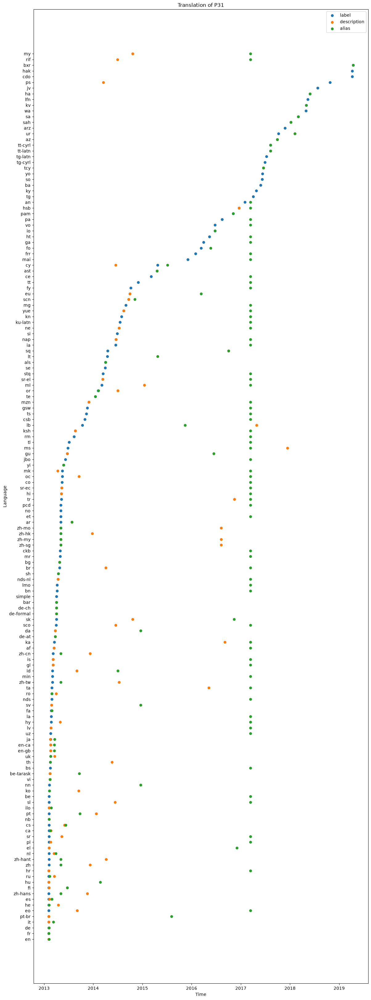
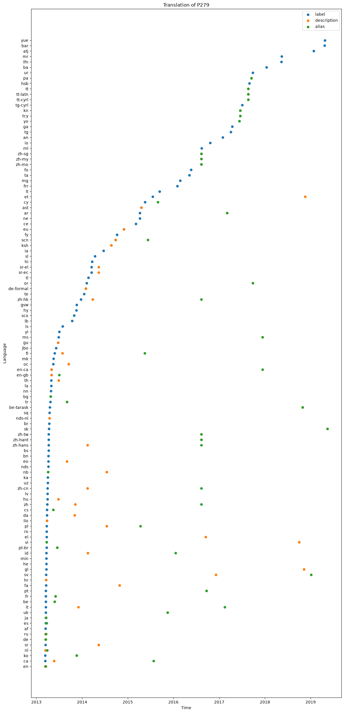
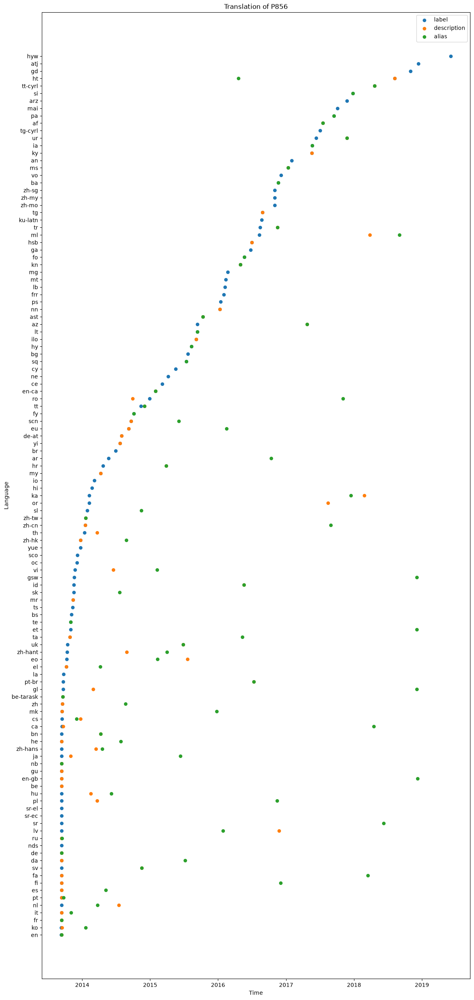

Année : 2026-2027
-----------------

Ce mini-projet sert d'exemple et d'entraînement pour l'exercice 2.4 du TP2. Il n'est pas noté et n'est pas à rendre : seul le [projet](projet.md) est évalué.

# Mini Projet : comprendre la traduction des propriétés Wikidata

## Objectifs

- Charger et nettoyer un vrai jeu de données d'événements avec pandas.
- Observer les modes de traduction à l'aide de graphiques.
- Extraire les ensembles fréquents de langues et les règles d'association (`mlxtend`).
- Visualiser le flux de traduction sous forme de graphe (`networkx`, `holoviews`).
- Prédire la prochaine langue d'une séquence de traduction : des modèles de référence simples, puis un réseau récurrent et un Transformer écrits avec Keras 3.
- Examiner les plongements (*embeddings*) de langues appris et ajouter une contrainte symbolique au modèle neuronal (un pont vers le bonus du projet).
- Diagnostiquer ce qui limite l'exactitude, puis améliorer les entrées (temps, tous les types de traduction) et la cible (le prochain *ensemble* de langues) du modèle.

Chaque exercice se termine par des **questions** : rédigez vos réponses dans des cellules markdown de votre copie du notebook.

Durée estimée : exercices 1.1 à 1.4 environ 1h30, exercice 1.5 environ 2h, exercice 1.6 environ 1h30.

## Préparation

Les bibliothèques ci-dessous sont listées dans le `requirements.txt` du cours. Si l'une d'elles manque, décommentez la ligne correspondante.

Le notebook utilise **Keras 3** (`import keras`), la version livrée avec TensorFlow ≥ 2.16. Le code est le même qu'avec `tf.keras`, mais écrit de la manière indépendante du *backend* recommandée par la documentation.

```python
# %pip install pandas numpy matplotlib scikit-learn mlxtend networkx holoviews bokeh tensorflow

import hashlib
import os
import urllib.request

import matplotlib.pyplot as plt
import numpy as np
import pandas as pd
import keras

SEED = 42
keras.utils.set_random_seed(SEED)
print("Keras", keras.__version__, "- backend:", keras.backend.backend())
```

## Exercice 1.1

### Téléchargement

Les données proviennent de <https://zenodo.org/records/3271358>. La cellule ci-dessous télécharge le fichier (9 Mo) s'il n'est pas déjà présent et vérifie sa somme MD5, de sorte que le notebook s'exécute du début à la fin sans étape manuelle.

Notez que ce jeu de données est un **instantané pris en juillet 2019** : il décrit les premières traductions des propriétés Wikidata entre 2013 et 2019. Wikidata a beaucoup changé depuis (environ deux fois plus de propriétés aujourd'hui), gardez-le à l'esprit en interprétant les résultats.

```python
DATA_URL = "https://zenodo.org/records/3271358/files/multilingual_wikidata_translation_flow.csv?download=1"
DATA_FILE = "multilingual_wikidata_translation_flow.csv"
DATA_MD5 = "7a6fa0bc0f6b335d521c67d87debacbf"

if not os.path.exists(DATA_FILE):
    urllib.request.urlretrieve(DATA_URL, DATA_FILE)

with open(DATA_FILE, "rb") as f:
    print("checksum OK:", hashlib.md5(f.read()).hexdigest() == DATA_MD5)
```

### Les données

Regardez le contenu des données. Comme vous pouvez le voir dans la sortie, il y a quatre colonnes : horodatage, propriété, langue et type.

Prenons un exemple de ligne de cet ensemble de données,

```
2013-09-10T22:43:54Z,P856,en,label
```

qui correspond à l'action « un libellé anglais de la propriété P856 a été ajouté pour la première fois le 2013-09-10T22:43:54Z ».

Voici une description de chaque colonne.

1. timestamp : l'heure à laquelle une action a été effectuée. Par exemple, 2013-09-10T22:43:54Z
2. property : identifiant de propriété Wikidata. Il utilise le numéro P, par exemple, P856
3. language : la langue dans laquelle un libellé/une description/un alias a été traduit pour la première fois
4. type : l'une des valeurs suivantes : label (libellé), description et alias

### Création du dataframe

Trois détails comptent au chargement du fichier :

- la ligne d'en-tête apparaît une seconde fois au milieu du fichier (le jeu de données a été construit en concaténant plusieurs exports), on la supprime ;
- les horodatages sont des chaînes de caractères : on les convertit une fois pour toutes en vraies dates (`pd.to_datetime`) au lieu d'analyser chaque ligne à la main ;
- tout ce qui suit dépend de l'**ordre chronologique** des lignes au sein d'une propriété. Le fichier se trouve être trié, mais on le trie explicitement pour que les séquences ne dépendent pas de la disposition du fichier.

```python
dataframe = pd.read_csv(DATA_FILE)

# the header line is repeated inside the file: drop it
dataframe = dataframe[dataframe["timestamp"] != "timestamp"]

# remove duplicates and rows with missing values
dataframe = dataframe.drop_duplicates().dropna()

# parse the dates once, then make the chronological order explicit
dataframe["timestamp"] = pd.to_datetime(dataframe["timestamp"], utc=True)
dataframe = dataframe.sort_values("timestamp", kind="stable").reset_index(drop=True)

print(dataframe)
```

Obtenez des informations détaillées sur le dataframe. `describe(include="all")` résume aussi les colonnes catégorielles (nombre de valeurs distinctes, valeur la plus fréquente).

```python
display(dataframe.describe(include="all"))

print("properties:", dataframe["property"].nunique())
print("languages:", dataframe["language"].nunique())
print("period:", dataframe["timestamp"].min().date(), "to", dataframe["timestamp"].max().date())
print(dataframe["type"].value_counts())
```

Regardons maintenant la traduction des libellés dans différentes langues pour une propriété donnée.

```python
dataframe.loc[(dataframe["property"] == "P856") & (dataframe["type"] == "label")]
```

Nous allons vérifier les données disponibles pour une propriété comme P856.

```python
ptranslation = dataframe.loc[(dataframe["property"] == "P856")]
print(ptranslation)
```

Vous pouvez aussi ajouter des conditions supplémentaires pour filtrer les informations. Le code ci-dessous filtre la traduction des libellés de la propriété P856. Testez-le avec d'autres propriétés et regardez la traduction des descriptions et des alias.

**Questions.** Quelles sont vos premières observations ? Quelle langue vient en premier ? Combien de temps s'écoule avant les premières traductions ?

```python
ptranslation = dataframe.loc[
    (dataframe["property"] == "P856") & (dataframe["type"] == "label")
]
print(ptranslation)
```

### Visualisation de la traduction

Notre prochain objectif est de tracer la traduction d'une propriété et de voir si l'on peut observer un mode de traduction. Plutôt que de recopier le même code de tracé pour chaque propriété, on écrit une fonction `plot_property` avec les paramètres :

- `pid` : l'identifiant de la propriété ;
- `y` : ce que l'on met sur l'axe des ordonnées, `"type"` (label/description/alias) ou `"language"` ;
- `languages` : une liste facultative de langues à conserver.

Le temps est toujours en abscisse et la couleur indique le type de traduction.

```python
TYPE_COLORS = {"label": "tab:blue", "description": "tab:orange", "alias": "tab:green"}


def plot_property(pid, y="type", languages=None, annotate=True, figsize=None, filename=None):
    """Scatter plot of the translation events of property `pid`: time on x, `y` on the y-axis."""
    data = dataframe[dataframe["property"] == pid]
    if languages is not None:
        data = data[data["language"].isin(languages)]
    if figsize is None:
        figsize = (14, 4) if y == "type" else (14, 0.25 * data["language"].nunique() + 2)

    fig, ax = plt.subplots(figsize=figsize)
    for kind, color in TYPE_COLORS.items():
        part = data[data["type"] == kind]
        ax.scatter(part["timestamp"], part[y], s=30, color=color, label=kind)

    # annotate the points with the language code
    if annotate and y == "type":
        for _, row in data.iterrows():
            ax.annotate(row["language"], (row["timestamp"], row["type"]), fontsize=7, rotation=45)

    ax.set_xlabel("Time")
    ax.set_ylabel(y.capitalize())
    ax.set_title(f"Translation of {pid}")
    ax.legend(loc="upper right")
    if filename:
        fig.savefig(filename, bbox_inches="tight")
    plt.show()


plot_property("P856", y="type")
```

Traçons maintenant un autre graphique, cette fois avec la langue en ordonnée et le temps en abscisse.

```python
plot_property("P279", y="language", filename="translation.png")
```

Examinez les graphiques des propriétés P31, P279 et P856. Vous pouvez aussi voir que certaines traductions sont faites en une seule modification : cherchez les colonnes verticales de points sur la figure de P31.

**Questions.** Que remarquez-vous sur les valeurs de l'axe des ordonnées ? Les langues sont-elles traduites dans le même ordre pour les trois propriétés ? Qu'est-ce qui pourrait expliquer les colonnes verticales ?







Dans le code ci-dessous, on sélectionne quelques langues et on regarde l'ordre de traduction. Tracez les graphiques pour différentes propriétés et notez vos observations.

```python
# list of languages under consideration
langlist = ["fr", "es", "en", "de", "it", "pt", "ja"]

plot_property("P18", y="language", languages=langlist, figsize=(10, 4))
```

## Exercice 1.2

Nous avons utilisé des graphiques pour détecter manuellement certains modes de traduction. Utilisons maintenant d'autres algorithmes pour voir si des groupes de langues sont toujours présents ensemble.

On prépare d'abord le jeu de données de langues. Nous nous concentrons sur la traduction des libellés des propriétés : pour chaque propriété, on construit la liste chronologique des langues dans lesquelles son libellé a été traduit. La fonction `translation_sequences` sera réutilisée dans les exercices suivants avec `kind="description"` ou `kind="alias"`.

```python
def translation_sequences(dataframe, kind="label"):
    """One chronological list of languages per property, for the given translation type."""
    subset = dataframe[dataframe["type"] == kind]
    # the dataframe is sorted by time, so each group is already in chronological order
    return subset.groupby("property", sort=False)["language"].apply(list)


languageorder = translation_sequences(dataframe, kind="label")
print(languageorder.head())
print(languageorder.loc["P856"])
```

Calculons maintenant les ensembles fréquents (*frequent itemsets*) avec l'algorithme *apriori*. `TransactionEncoder` transforme la liste des séquences en une table booléenne (une ligne par propriété, une colonne par langue). Décommentez la ligne `display` pour voir ce dataframe intermédiaire.

```python
from mlxtend.frequent_patterns import apriori
from mlxtend.preprocessing import TransactionEncoder

te = TransactionEncoder()
te_ary = te.fit(languageorder.tolist()).transform(languageorder.tolist())
df = pd.DataFrame(te_ary, columns=te.columns_)
# display(df)

frequent_itemsets = apriori(df, min_support=0.75, use_colnames=True)
frequent_itemsets.sort_values("support", ascending=False)
```

Le programme utilise un support minimum de 0,75 : un ensemble est conservé s'il est présent dans au moins 75 % des propriétés. Les libellés anglais sont présents pour toutes les propriétés, alors que les libellés français ne sont disponibles que pour environ 93 % d'entre elles. En considérant les paires de langues, on voit des combinaisons comme (en, ar) ou (nl, uk) presque toujours présentes ensemble. Plus bas, on voit des combinaisons de 3, 4, 5 langues.

**Questions.**
- Faites varier le support minimum entre 0 et 1 et regardez la sortie. Que deviennent le nombre d'ensembles et le temps de calcul quand le support diminue ?
- Répétez l'expérience pour les descriptions et les alias (`translation_sequences(dataframe, kind="description")`). Retrouve-t-on les mêmes langues ?

## Exercice 1.3

Notre prochain objectif est de générer les règles d'association, c'est-à-dire des règles de la forme *A → C*, où A est l'antécédent et C le conséquent.

```python
from mlxtend.frequent_patterns import association_rules

association_rules(frequent_itemsets, metric="confidence", min_threshold=0.95)
```

Regardons une des règles d'association, par exemple *(de, fr) → (en)* : quand les traductions française et allemande sont disponibles, la traduction anglaise l'est aussi, avec une confiance proche de 1. Notez qu'une confiance élevée ne veut pas dire que la règle est intéressante : l'anglais est présent presque partout, donc toute règle *X → (en)* a une confiance élevée. La colonne *lift* corrige cet effet (un lift proche de 1 signifie que A et C sont indépendants).

Vous pouvez remplacer la métrique par `"lift"` et tester.

Ajoutons maintenant deux colonnes contenant la longueur des antécédents et des conséquents. Comme vous l'avez remarqué, les règles d'association sont des dataframes : on peut donc facilement écrire des conditions de filtrage pour obtenir des antécédents et des conséquents de longueur supérieure à 1.

```python
arules = association_rules(frequent_itemsets, metric="confidence", min_threshold=0.95)

arules["antecedent_len"] = arules["antecedents"].apply(len)
arules["consequent_len"] = arules["consequents"].apply(len)

arules.loc[(arules["antecedent_len"] > 1) & (arules["consequent_len"] > 1)]
```

**Questions.** Répétez l'expérience ci-dessus pour la traduction des descriptions et des alias. Quelles règles ont le lift le plus élevé ? Trouvez-vous des règles entre des langues linguistiquement ou géographiquement proches ?

## Exercice 1.4

Notre prochain objectif est de visualiser le flux de traduction. On compte d'abord, sur toutes les séquences de libellés, combien de fois une langue est directement suivie d'une autre : chaque paire consécutive (source, cible) est une arête d'un graphe orienté et son nombre d'occurrences est son poids.

```python
def language_pairs(sequences):
    """Count the consecutive (source, target) language pairs of the sequences."""
    pairs = [(seq[i], seq[i + 1]) for seq in sequences for i in range(len(seq) - 1)]
    flows = pd.DataFrame(pairs, columns=["source", "target"])
    return flows.value_counts().reset_index(name="count")


flows = language_pairs(languageorder)
print(flows)
```

Visualisons-les ensuite avec une disposition circulaire. Le graphe est orienté et l'épaisseur d'une arête est proportionnelle à son poids. On ne garde que les `TOP_EDGES` paires les plus fréquentes pour que la figure reste lisible.

```python
import networkx as nx

TOP_EDGES = 60
top_flows = flows.head(TOP_EDGES)

G = nx.from_pandas_edgelist(top_flows, "source", "target", edge_attr="count", create_using=nx.DiGraph)
pos = nx.circular_layout(G)
widths = [8 * G[u][v]["count"] / top_flows["count"].max() for u, v in G.edges]

plt.figure(figsize=(12, 12))
nx.draw(
    G, pos, with_labels=True, width=widths, node_color="lightblue", node_size=1200,
    edge_color="gray", arrowsize=15, connectionstyle="arc3,rad=0.1",
)
plt.show()
```

Examinez le flux de traduction pour des langues de votre choix (nombre de langues > 20) : filtrez `flows` sur `source` et `target`, ou augmentez `TOP_EDGES`.

Le diagramme en cordes (*chord diagram*) de Holoviews/Bokeh montre les poids plus clairement : l'épaisseur d'un ruban est le nombre de transitions entre les deux langues. Survolez un ruban pour lire sa valeur.

```python
import holoviews as hv

hv.extension("bokeh")

chord = hv.Chord(top_flows).opts(
    width=650, height=650, labels="index", node_color="index", edge_color="source",
    cmap="Category20", edge_cmap="Category20", title=f"{TOP_EDGES} most frequent transitions (labels)",
)
chord
```

**Questions.** Quelle langue est la principale *source* du flux ? Quelles langues sont surtout des *cibles* ? Les transitions trouvées ici concordent-elles avec les règles d'association de l'exercice 1.3 ? Notez qu'une règle d'association ignore l'ordre, alors qu'une transition le conserve.

## Exercice 1.5 : prédire la prochaine langue

Notre objectif final est de prédire la ou les prochaines langues de traduction, étant donné une séquence de traductions disponibles.

Supposons par exemple que nous ayons observé les séquences de traduction suivantes.

```
[['en', 'it', 'fi', 'fr', 'de', 'nl', 'pt', 'pl', 'ca', 'cs'],
 ['en', 'it', 'fi', 'fr', 'de', 'ilo', 'zh', 'nb'],
 ['ru', 'hu', 'he', 'nl', 'pt', 'pl', 'ca', 'cs'],
 ...]
```

Une fois votre modèle entraîné sur ces données, il devrait pouvoir prédire la ou les prochaines traductions possibles.

**Exemple 1** : si l'utilisateur saisit la séquence `['pt']`, votre modèle peut renvoyer `['pl']`.

**Exemple 2** : si l'utilisateur saisit la séquence `['it', 'fi']`, votre modèle peut renvoyer `['fr']`.

**Exemple 3** : si l'utilisateur saisit la séquence `['nl', 'pt', 'pl']`, votre modèle peut renvoyer `['ca', 'cs']`.

### 1.5.1 Des séquences à un problème de prédiction

Regardons à nouveau le problème : étant donné les « jetons » (*tokens*) précédents d'une séquence, prédire le suivant, où un jeton est un code de langue. C'est exactement la tâche résolue par un **modèle de langue** — celui qui se trouve derrière les grands modèles de langue actuels — sauf que notre vocabulaire compte quelques centaines de codes de langues au lieu de dizaines de milliers de morceaux de mots. Nous allons donc suivre la même recette :

1. construire un vocabulaire et encoder chaque langue par un entier ;
2. découper chaque séquence en exemples d'apprentissage (contexte → langue suivante) ;
3. comparer sur le même jeu de test des modèles de complexité croissante : des modèles de référence fondés sur des comptages, un réseau récurrent, un Transformer.

Deux détails importants :

- **Découpage** : on répartit les *propriétés* (séquences entières) entre les ensembles d'entraînement, de validation et de test, jamais les exemples. Deux exemples issus de la même séquence partagent l'essentiel de leur contexte : répartir les exemples ferait fuir de l'information du jeu de test vers le jeu d'entraînement. La variable `SPLIT` permet aussi d'essayer un découpage *temporel* (entraîner sur les propriétés les plus anciennes, tester sur les plus récentes), plus proche de l'usage réel d'un tel modèle.
- **Vocabulaire** : il est construit à partir des seules séquences d'entraînement. Une langue qui n'apparaît que dans le jeu de test est inconnue du modèle et encodée par `<unk>` ; l'indice 0 est réservé au remplissage (*padding*).

La variable `KIND` sélectionne les libellés, les descriptions ou les alias : l'exercice est à faire pour les trois types.

```python
from sklearn.model_selection import train_test_split

KIND = "label"      # "label", "description" or "alias"
SPLIT = "random"    # "random" or "temporal"
MAX_LEN = 20        # number of previous languages given to the model

sequences = translation_sequences(dataframe, kind=KIND)
sequences = sequences[sequences.str.len() >= 2]  # a sequence of length 1 gives no example

if SPLIT == "random":
    property_ids = sequences.index.to_numpy()
    train_ids, test_ids = train_test_split(property_ids, test_size=0.2, random_state=SEED)
    val_ids, test_ids = train_test_split(test_ids, test_size=0.5, random_state=SEED)
else:
    # order the properties by the date of their first translation
    first_seen = dataframe[dataframe["type"] == KIND].groupby("property")["timestamp"].min()
    ordered = first_seen.loc[sequences.index].sort_values().index
    n = len(ordered)
    train_ids, val_ids, test_ids = ordered[: int(0.8 * n)], ordered[int(0.8 * n) : int(0.9 * n)], ordered[int(0.9 * n) :]

print(f"{len(sequences)} sequences: {len(train_ids)} train, {len(val_ids)} validation, {len(test_ids)} test")
```

```python
PAD, UNK = 0, 1
vocab = ["<pad>", "<unk>"] + sorted({lang for pid in train_ids for lang in sequences[pid]})
lang2id = {lang: i for i, lang in enumerate(vocab)}
V = len(vocab)
print("vocabulary size:", V)


def encode(languages):
    return [lang2id.get(lang, UNK) for lang in languages]


def make_examples(ids):
    """Cut the sequences into (context of at most MAX_LEN languages, next language) pairs."""
    X, y = [], []
    for pid in ids:
        seq = encode(sequences[pid])
        for t in range(1, len(seq)):
            if seq[t] == UNK:  # an unknown language cannot be predicted: skip
                continue
            X.append(seq[max(0, t - MAX_LEN) : t])
            y.append(seq[t])
    # pad on the left so that the most recent language is always in the last column
    X = keras.utils.pad_sequences(X, maxlen=MAX_LEN, padding="pre", value=PAD)
    return X, np.array(y)


X_train, y_train = make_examples(train_ids)
X_val, y_val = make_examples(val_ids)
X_test, y_test = make_examples(test_ids)
print("examples:", len(X_train), "train,", len(X_val), "validation,", len(X_test), "test")
print("example:", [vocab[i] for i in X_train[5] if i != PAD], "->", vocab[y_train[5]])
```

### Métriques

Plusieurs langues suivantes sont souvent aussi plausibles les unes que les autres, l'exactitude exacte (*top-1*) est donc un critère sévère. On rapporte aussi :

- **top-5 accuracy** : la vraie langue est parmi les 5 meilleurs scores ;
- **MRR** (*mean reciprocal rank*) : la moyenne de 1 / rang de la vraie langue, qui récompense un modèle plaçant la bonne réponse haut dans son classement.

`evaluate` prend une matrice de scores (une ligne par exemple, une colonne par langue) pour pouvoir servir à tous les modèles ci-dessous, neuronaux ou non.

```python
def evaluate(scores, y, k=5):
    """Ranking metrics from a (n_examples, V) score matrix; higher score = more likely."""
    ranking = np.argsort(-scores, axis=1)
    rank = np.argmax(ranking == y[:, None], axis=1) + 1  # position of the true language
    return {"top-1": np.mean(rank == 1), f"top-{k}": np.mean(rank <= k), "MRR": np.mean(1 / rank)}


results = {}
```

### 1.5.2 Modèles de référence sans apprentissage

Avant d'entraîner un réseau de neurones, il faut savoir ce qu'obtient un modèle trivial — sinon, comment savoir que le réseau a appris quelque chose ?

- **Fréquence** : prédire toujours les langues suivantes les plus fréquentes du jeu d'entraînement, quel que soit le contexte.
- **Bigramme** : prédire à partir de la dernière langue seulement, avec les comptages de transitions de l'exercice 1.4 (et un petit lissage additif pour que les transitions jamais vues n'aient pas un score nul). C'est une *chaîne de Markov*.
- **Règles d'association** : réutiliser l'exercice 1.3. Pour une séquence d'entrée, chaque règle dont l'antécédent est inclus dans l'entrée vote pour son conséquent avec sa confiance. Les règles sont extraites des seules séquences d'entraînement.

```python
# frequency baseline
frequency = np.bincount(y_train, minlength=V).astype(float)
scores_frequency = np.tile(frequency, (len(X_test), 1))
results["frequency"] = evaluate(scores_frequency, y_test)

# bigram (Markov chain) baseline
ALPHA = 0.1
transitions = np.full((V, V), ALPHA)
np.add.at(transitions, (X_train[:, -1], y_train), 1)
transitions /= transitions.sum(axis=1, keepdims=True)
results["bigram"] = evaluate(transitions[X_test[:, -1]], y_test)

pd.DataFrame(results).T
```

```python
# association rules baseline: mine the rules on the training sequences only
train_sets = [sequences[pid] for pid in train_ids]
te_train = TransactionEncoder()
df_train = pd.DataFrame(te_train.fit(train_sets).transform(train_sets), columns=te_train.columns_)
itemsets_train = apriori(df_train, min_support=0.05, use_colnames=True, max_len=3)
rules = association_rules(itemsets_train, metric="confidence", min_threshold=0.5)
rules = rules[rules["consequents"].apply(len) == 1]
print(len(itemsets_train), "itemsets,", len(rules), "rules")


def rules_scores(X):
    """Each applicable rule votes for its consequent with its confidence."""
    present = np.zeros((len(X), V), dtype=bool)
    np.put_along_axis(present, X, True, axis=1)
    present[:, PAD] = False
    scores = np.tile(frequency / frequency.sum(), (len(X), 1)) * 1e-3  # tie-breaker when no rule applies
    for antecedent, consequent, confidence in zip(rules["antecedents"], rules["consequents"], rules["confidence"]):
        applies = present[:, encode(antecedent)].all(axis=1)
        scores[applies, encode(consequent)[0]] += confidence
    return scores


results["association rules"] = evaluate(rules_scores(X_test), y_test)
pd.DataFrame(results).T
```

### 1.5.3 Réseau de neurones récurrent

Le premier modèle neuronal est celui suggéré dans la version initiale de cet exercice : une couche `Embedding` transforme chaque langue en un vecteur de `EMBEDDING_DIM` nombres, une couche `LSTM` lit la séquence de vecteurs et la résume, et une couche `Dense` avec une activation softmax donne une probabilité à chaque langue du vocabulaire. `mask_zero=True` indique au LSTM d'ignorer le remplissage (`use_cudnn=False` est nécessaire sur GPU car le noyau rapide cuDNN ne gère que le remplissage à droite, alors que nous remplissons à gauche).

La fonction de perte est `sparse_categorical_crossentropy` car la cible est un entier (l'indice de la prochaine langue). On arrête l'entraînement quand la perte de validation cesse de s'améliorer (`EarlyStopping`). Dix époques prennent quelques minutes sur un CPU ; augmentez `epochs` si la courbe de validation descend encore.

```python
EMBEDDING_DIM = 32


def build_rnn(units=64):
    inputs = keras.Input(shape=(MAX_LEN,), dtype="int32")
    x = keras.layers.Embedding(V, EMBEDDING_DIM, mask_zero=True, name="language_embedding")(inputs)
    # the cuDNN kernel only accepts right-padded masks; our sequences are left-padded
    x = keras.layers.LSTM(units, use_cudnn=False)(x)
    x = keras.layers.Dropout(0.2)(x)
    outputs = keras.layers.Dense(V, activation="softmax")(x)
    return keras.Model(inputs, outputs, name="lstm")


def train(model, x=None, y=None, validation_data=None, epochs=10, batch_size=128,
          loss="sparse_categorical_crossentropy", metrics=None):
    if x is None:  # default: the next-language examples
        x, y, validation_data = X_train, y_train, (X_val, y_val)
    if metrics is None:
        metrics = ["accuracy", keras.metrics.SparseTopKCategoricalAccuracy(k=5, name="top5")]
    model.compile(optimizer="adam", loss=loss, metrics=metrics)
    early_stopping = keras.callbacks.EarlyStopping(patience=2, restore_best_weights=True)
    return model.fit(
        x, y, validation_data=validation_data,
        epochs=epochs, batch_size=batch_size, callbacks=[early_stopping], verbose=2,
    )


def plot_history(history, title, metric="accuracy"):
    fig, axes = plt.subplots(1, 2, figsize=(12, 4))
    for ax, metric in zip(axes, ["loss", metric]):
        ax.plot(history.history[metric], label="train")
        ax.plot(history.history["val_" + metric], label="validation")
        ax.set_xlabel("epoch")
        ax.set_ylabel(metric)
        ax.legend()
    fig.suptitle(title)
    plt.show()


rnn = build_rnn()
rnn.summary()
history_rnn = train(rnn)
plot_history(history_rnn, "LSTM")

results["LSTM"] = evaluate(rnn.predict(X_test, verbose=0), y_test)
pd.DataFrame(results).T
```

### 1.5.4 Transformer

Les réseaux récurrents lisent la séquence une langue à la fois. Le **Transformer** (Vaswani et al., 2017) remplace la récurrence par l'*auto-attention* : chaque position regarde d'un coup toutes les positions précédentes et apprend lesquelles comptent pour la prédiction. C'est l'architecture de tous les grands modèles de langue actuels. Deux ingrédients sont nécessaires :

- comme l'attention n'a pas de notion d'ordre, on ajoute un **plongement de position** au plongement de langue (`TokenAndPositionEmbedding`) ;
- un **masque causal** pour qu'une position ne puisse regarder que celles qui la précèdent, combiné à un **masque de remplissage** qui cache le padding à gauche des séquences courtes.

`keras.layers.MultiHeadAttention` fait l'essentiel du travail : avec `use_causal_mask=True`, elle construit elle-même le masque causal, et on lui fournit le masque de remplissage via `attention_mask`. Le bloc décodeur ci-dessous est le bloc standard « attention → addition & normalisation → feed-forward → addition & normalisation ». On en empile `NUM_BLOCKS` et on garde la sortie de la dernière position pour prédire la prochaine langue.

```python
class TokenAndPositionEmbedding(keras.layers.Layer):
    """Language embedding + learned position embedding."""

    def __init__(self, vocab_size, max_len, d_model, **kwargs):
        super().__init__(**kwargs)
        self.token_embedding = keras.layers.Embedding(vocab_size, d_model)
        self.position_embedding = keras.layers.Embedding(max_len, d_model)

    def call(self, x):
        positions = keras.ops.arange(0, keras.ops.shape(x)[-1])
        return self.token_embedding(x) + self.position_embedding(positions)


class TransformerBlock(keras.layers.Layer):
    """Causal self-attention followed by a feed-forward network, each with a residual connection."""

    def __init__(self, d_model, num_heads, ff_dim, dropout=0.1, **kwargs):
        super().__init__(**kwargs)
        self.attention = keras.layers.MultiHeadAttention(num_heads, d_model // num_heads, dropout=dropout)
        self.ffn = keras.Sequential([keras.layers.Dense(ff_dim, activation="relu"), keras.layers.Dense(d_model)])
        self.norm1 = keras.layers.LayerNormalization()
        self.norm2 = keras.layers.LayerNormalization()
        self.dropout = keras.layers.Dropout(dropout)

    def call(self, x, padding_mask=None):
        attention = self.attention(x, x, attention_mask=padding_mask, use_causal_mask=True)
        x = self.norm1(x + self.dropout(attention))
        return self.norm2(x + self.dropout(self.ffn(x)))


def build_transformer(d_model=32, num_heads=4, ff_dim=64, num_blocks=2):
    inputs = keras.Input(shape=(MAX_LEN,), dtype="int32")
    # (batch, 1, MAX_LEN): which keys may be attended to
    padding_mask = keras.ops.expand_dims(keras.ops.not_equal(inputs, PAD), 1)
    x = TokenAndPositionEmbedding(V, MAX_LEN, d_model, name="language_embedding")(inputs)
    for _ in range(num_blocks):
        x = TransformerBlock(d_model, num_heads, ff_dim)(x, padding_mask=padding_mask)
    x = x[:, -1, :]  # representation of the last position
    outputs = keras.layers.Dense(V, activation="softmax")(x)
    return keras.Model(inputs, outputs, name="transformer")


transformer = build_transformer()
transformer.summary()
history_transformer = train(transformer)
plot_history(history_transformer, "Transformer")

results["Transformer"] = evaluate(transformer.predict(X_test, verbose=0), y_test)
pd.DataFrame(results).T
```

### 1.5.5 Comparaison

Tous les modèles ont été évalués sur les mêmes exemples de test, le tableau se lit donc ligne par ligne.

**Questions.**
- Quel modèle de référence est le plus difficile à battre ? Pourquoi le modèle bigramme est-il si bon sur ce jeu de données (pensez aux colonnes verticales de l'exercice 1.1) ?
- Comparez le LSTM et le Transformer : exactitude, nombre de paramètres, temps d'entraînement. Changez `MAX_LEN` (5, 10, 40) : quel modèle profite d'un contexte plus long ?
- Le classement des modèles est-il le même avec `SPLIT = "temporal"` ? Quel découpage vous semble l'estimation la plus honnête de la performance sur de nouvelles propriétés ?
- Recommencez avec `KIND = "description"` et `KIND = "alias"`. Les séquences sont-elles aussi prévisibles ?

```python
comparison = pd.DataFrame(results).T
display(comparison)

comparison.plot.bar(figsize=(10, 4), rot=0, title=f"Next-language prediction ({KIND}, {SPLIT} split)")
plt.ylabel("score on the test set")
plt.show()
```

### 1.5.6 Utiliser le modèle

`predict_next` renvoie les `k` prochaines langues les plus probables avec leur probabilité. Testez les trois exemples donnés au début de l'exercice.

**Question.** Le modèle répond `en` à `['pt']` plutôt que `pl`. Pourquoi ? (Regardez quelle langue commence presque toutes les séquences, et demandez-vous ce que le modèle a vu juste avant un `pt` qui n'est *pas* précédé de `en`.)

```python
def predict_next(model, languages, k=3):
    x = keras.utils.pad_sequences([encode(languages)[-MAX_LEN:]], maxlen=MAX_LEN, value=PAD)
    probabilities = model.predict(x, verbose=0)[0]
    top = np.argsort(-probabilities)[:k]
    return [(vocab[i], round(float(probabilities[i]), 3)) for i in top]


for example in [["pt"], ["it", "fi"], ["nl", "pt", "pl"], ["en"], ["en", "fr", "de"]]:
    print(example, "->", predict_next(transformer, example))
```

### 1.5.7 Qu'a appris le modèle ? Les plongements de langues

La couche `Embedding` a appris un vecteur par langue. Les langues qui jouent un rôle similaire dans les séquences devraient obtenir des vecteurs similaires. On projette en deux dimensions, par ACP, les vecteurs des langues les plus fréquentes et on les colore par famille de langues (obtenue depuis Wikidata, voir ci-dessous). Les vecteurs sont d'abord normalisés, sinon le premier axe reflète surtout la fréquence de la langue.

```python
from sklearn.decomposition import PCA

# language family of the most frequent languages, obtained from Wikidata (see 1.5.8)
FAMILY = {
    "en": "Germanic", "de": "Germanic", "nl": "Germanic", "sv": "Germanic", "da": "Germanic", "nb": "Germanic",
    "nn": "Germanic", "sco": "Germanic", "fr": "Romance", "es": "Romance", "it": "Romance", "pt": "Romance",
    "ca": "Romance", "ro": "Romance", "gl": "Romance", "ast": "Romance", "oc": "Romance", "scn": "Romance",
    "uk": "Slavic", "ru": "Slavic", "pl": "Slavic", "cs": "Slavic", "sk": "Slavic", "sl": "Slavic", "bg": "Slavic",
    "mk": "Slavic", "sr": "Slavic", "bs": "Slavic", "be": "Slavic", "lv": "Baltic", "el": "Hellenic", "cy": "Celtic",
    "fa": "Iranian", "bn": "Indo-Aryan", "sq": "Albanian", "hu": "Uralic", "fi": "Uralic", "et": "Uralic",
    "tr": "Turkic", "ar": "Semitic", "he": "Semitic", "zh": "Sino-Tibetan", "ja": "Japonic", "ko": "Koreanic",
    "id": "Austronesian", "ms": "Austronesian", "vi": "Austroasiatic", "eu": "Basque", "eo": "constructed",
}


def family_of(code):
    # "zh-hans", "pt-br", "be-tarask"... share the family of their base language
    return FAMILY.get(code, FAMILY.get(code.split("-")[0], "other"))


def plot_embeddings(embeddings, languages, title, min_family_size=2):
    # normalise the vectors so that the projection reflects their direction, not the frequency of the language
    embeddings = embeddings / np.linalg.norm(embeddings, axis=1, keepdims=True)
    points = PCA(n_components=2, random_state=SEED).fit_transform(embeddings)

    # only colour the families with several languages in the plot
    families = pd.Series([family_of(lang) for lang in languages])
    counts = families.value_counts()
    families = families.where(families.map(counts) >= min_family_size, "other")
    palette = dict(zip(sorted(families.unique()), plt.cm.tab10(np.linspace(0, 1, families.nunique()))))

    fig, ax = plt.subplots(figsize=(12, 9))
    for family, color in palette.items():
        idx = np.where(families == family)[0]
        ax.scatter(points[idx, 0], points[idx, 1], color=color, label=family, s=60)
    for i, lang in enumerate(languages):
        ax.annotate(lang, (points[i, 0], points[i, 1]), fontsize=9, xytext=(3, 3), textcoords="offset points")
    ax.set_title(title)
    ax.legend(loc="best")
    plt.show()


TOP_LANGUAGES = 50
frequent_ids = np.argsort(-frequency)[:TOP_LANGUAGES]
embeddings = rnn.get_layer("language_embedding").get_weights()[0]
plot_embeddings(embeddings[frequent_ids], [vocab[i] for i in frequent_ids], "LSTM language embeddings (PCA)")
```

**Questions.**
- Les langues d'une même famille se retrouvent-elles proches ? Les variantes d'une langue (`zh`, `zh-hans`, `zh-hant` ; `pt`, `pt-br` ; `sr`, `sr-ec`, `sr-el`) sont-elles proches ?
- Quel autre facteur pourrait expliquer la proximité de deux langues sur ce graphique ? (Pensez à *qui* traduit les propriétés : quelques contributeurs très actifs et des robots.)
- Tracez les plongements du Transformer (`transformer.get_layer("language_embedding").token_embedding.get_weights()[0]`) et comparez.

### 1.5.8 Ajouter une contrainte symbolique

Le projet récompense l'intégration d'une composante symbolique. En voici la plus simple possible : une langue déjà présente dans la séquence a *déjà* été traduite, elle ne peut donc pas être la suivante. Un réseau de neurones doit apprendre cette règle à partir des données (et il ne l'apprend jamais parfaitement), alors que nous pouvons simplement l'imposer : on met à zéro le score des langues présentes dans l'entrée avant de classer. C'est une règle appliquée *après* le modèle, elle fonctionne donc avec tous les modèles de ce notebook.

```python
def forbid_seen_languages(scores, X):
    """Rule: a language already present in the input cannot be the next translation."""
    scores = scores.copy()
    np.put_along_axis(scores, X, -np.inf, axis=1)
    scores[:, PAD] = -np.inf
    return scores


constrained = {
    "frequency": scores_frequency,
    "bigram": transitions[X_test[:, -1]],
    "association rules": rules_scores(X_test),
    "LSTM": rnn.predict(X_test, verbose=0),
    "Transformer": transformer.predict(X_test, verbose=0),
}
for name, scores in constrained.items():
    results[name + " + rule"] = evaluate(forbid_seen_languages(scores, X_test), y_test)

pd.DataFrame(results).T.sort_values("MRR", ascending=False)
```

**Questions.**
- Quels modèles profitent le plus de la règle ? Pourquoi le Transformer ou le LSTM en profitent-ils moins que le modèle de fréquence ?
- La règle ne voit que les `MAX_LEN` dernières langues. Comment lui donner la séquence complète ?
- (Bonus) Wikidata connaît la famille et le système d'écriture de chaque langue. La requête ci-dessous les récupère en SPARQL (elle nécessite une connexion internet : mettez `USE_WIKIDATA = True`). Utilisez-les pour construire une seconde règle ou une entrée supplémentaire du modèle — par exemple « une langue de la même famille que la dernière est plus probable » — et mesurez si cela aide. Que cela aide ou non, expliquez pourquoi : la réponse vous apprend quelque chose sur la manière dont Wikidata est réellement traduit.

```python
USE_WIKIDATA = False

SPARQL = """
SELECT ?code (GROUP_CONCAT(DISTINCT ?familyLabel; separator="|") AS ?families)
             (GROUP_CONCAT(DISTINCT ?scriptLabel; separator="|") AS ?scripts) WHERE {
  VALUES ?code { %s }
  ?lang wdt:P424 ?code .          # Wikimedia language code
  ?lang wdt:P1394 ?glottolog .    # keep languages (not language variants)
  OPTIONAL { ?lang wdt:P279+ ?family . ?family wdt:P31 wd:Q25295 .
             ?family rdfs:label ?familyLabel FILTER(LANG(?familyLabel) = "en") }
  OPTIONAL { ?lang wdt:P282 ?script . ?script rdfs:label ?scriptLabel FILTER(LANG(?scriptLabel) = "en") }
} GROUP BY ?code
"""

if USE_WIKIDATA:
    import io
    import requests

    codes = " ".join(f'"{vocab[i]}"' for i in frequent_ids)
    response = requests.get(
        "https://query.wikidata.org/sparql",
        params={"query": SPARQL % codes},
        headers={"Accept": "text/csv", "User-Agent": "IA-DeepLearning-miniproject/1.0"},
    )
    language_info = pd.read_csv(io.StringIO(response.text))
    display(language_info)
```

### 1.5.9 Pour aller plus loin

- **Séquence → ensemble.** L'exemple 3 attend *deux* langues. Transformez le problème en problème multi-étiquettes : prédire l'ensemble des `k` prochaines langues avec une sortie sigmoïde et une perte `binary_crossentropy`, et évaluez avec la précision@k.
- **Poids d'attention.** Appelez `MultiHeadAttention` avec `return_attention_scores=True` et affichez, pour une entrée donnée, quelles langues précédentes la dernière position regarde.
- **Grands modèles de langue.** Demandez à un LLM (sans exemple) de prédire la prochaine langue de quelques séquences de test et comparez ses réponses à celles de vos modèles. Lequel connaît les habitudes de la communauté Wikidata ? Rappelez-vous que l'utilisation d'assistants IA doit être citée dans le rapport du projet.

Commentez votre code et notez vos observations : quelle est la longueur maximale de la séquence d'entrée ? Quelles sont les métriques de chaque modèle ? Pourquoi avoir choisi telle architecture et tels hyperparamètres ?

## Exercice 1.6 : pourquoi l'exactitude est-elle si faible, et que faire ?

Une exactitude top-1 d'environ 23 % semble médiocre. Avant d'essayer des modèles plus gros, un *data scientist* se pose deux questions : *la tâche est-elle vraiment prévisible à partir de ces entrées ?* et *quelle information manque au modèle ?* Cet exercice répond aux deux, puis modifie en conséquence les entrées et la cible du modèle. Il entraîne trois Transformers de plus : environ 3 minutes sur GPU, 15 sur CPU.

### 1.6.1 Diagnostic

Trois choses à regarder :

1. **Combien de temps s'écoule entre deux traductions consécutives ?** Si la traduction suivante arrive des mois plus tard, elle est faite par la personne qui passe par là, et la séquence nous dit peu de choses sur elle.
2. **La réponse change-t-elle au fil des années ?** La communauté Wikidata, ses outils et ses robots ont beaucoup changé entre 2013 et 2019. Si la langue la plus probable après `en` est différente chaque année, un modèle qui ne connaît pas l'année doit faire la moyenne de toutes.
3. **Quelle est l'incertitude minimale sur la prochaine langue ?** L'*entropie conditionnelle* H(suivante | précédente) mesure l'incertitude qui subsiste une fois la langue précédente connue. 2^H est le nombre de langues équiprobables auquel elle correspond : c'est le plafond qu'un modèle n'utilisant que la langue précédente peut atteindre.

On compare aussi l'exactitude d'entraînement et de validation du Transformer : si elles sont égales, le modèle ne sur-apprend pas ; il est limité par ses entrées, pas par sa taille.

```python
events = dataframe[dataframe["type"] == KIND].copy()
by_property = events.groupby("property", sort=False)
events["previous_language"] = by_property["language"].shift()
events["gap"] = (events["timestamp"] - by_property["timestamp"].shift()).dt.total_seconds()
events = events.dropna(subset=["previous_language"])  # keep the events that are prediction targets

# 1. time between consecutive translations
gap = events["gap"]
print(f"same second as the previous translation: {(gap == 0).mean():.1%}")
print(f"within one hour: {(gap <= 3600).mean():.1%}")
print(f"more than 30 days later: {(gap > 30 * 86400).mean():.1%}")

# 2. the most frequent language after "en", year by year
after_en = events[events["previous_language"] == "en"]
most_common = lambda s: f"{s.mode()[0]} ({s.value_counts(normalize=True).iloc[0]:.0%})"
print("\nmost frequent language after 'en':")
print(after_en.groupby(after_en["timestamp"].dt.year)["language"].agg(most_common).to_string())

# 3. conditional entropy of the next language given the previous one
p = events.groupby("previous_language")["language"].value_counts(normalize=True)
entropy = -(p * np.log2(p)).groupby(level=0).sum()
weights = events["previous_language"].value_counts(normalize=True)
H = (entropy * weights.reindex(entropy.index)).sum()
print(f"\nH(next | previous) = {H:.2f} bits: as uncertain as a choice among {2 ** H:.0f} equally likely languages")

# 4. is the Transformer overfitting?
print(f"\nTransformer accuracy - train: {history_transformer.history['accuracy'][-1]:.3f}, "
      f"validation: {history_transformer.history['val_accuracy'][-1]:.3f}")
```

**Questions.**
- Quelle fraction des cibles sont des « visites indépendantes » (plus d'un mois après la traduction précédente) ? Que peut en dire un modèle de séquence ?
- Lisez le tableau année par année : quelle langue domine en 2017 ? Que cela suggère-t-il sur *qui* (ou quel robot) traduisait cette année-là ?
- Avec une entropie conditionnelle d'environ 5 bits, quelle exactitude top-1 attendriez-vous d'un modèle bigramme ? Comparez avec la valeur obtenue à l'exercice 1.5. Le Transformer est-il loin du plafond de ses entrées ?

Puisque les modèles ne sur-apprennent pas, la voie à suivre est de leur donner de **meilleures entrées** (1.6.2, 1.6.3) ou de leur poser une **meilleure question** (1.6.4).

### 1.6.2 Donner le temps au modèle

Les modèles de l'exercice 1.5 ne voient que des codes de langues. On ajoute deux caractéristiques connues au moment de la prédiction :

- l'**année** de la dernière traduction connue ;
- le **temps écoulé** entre les deux dernières traductions connues, sur une échelle logarithmique (0 : même seconde, 2 : minutes, 5 : un jour, 7 : des mois), comme indicateur de l'activité autour de la propriété.

Chaque caractéristique reçoit son propre petit plongement, concaténé à la représentation de la séquence produite par le Transformer. `transformer_features` reconstruit le corps du Transformer de 1.5.4 pour que la même architecture soit réutilisable avec d'autres entrées et sorties.

```python
timestamps = dataframe[dataframe["type"] == KIND].groupby("property", sort=False)["timestamp"].apply(list)
YEARS = sorted(dataframe["timestamp"].dt.year.unique())
GAP_BUCKETS = 10


def make_examples_with_time(ids):
    X, years, gaps, y = [], [], [], []
    for pid in ids:
        seq, times = encode(sequences[pid]), timestamps[pid]
        for t in range(1, len(seq)):
            if seq[t] == UNK:
                continue
            X.append(seq[max(0, t - MAX_LEN) : t])
            y.append(seq[t])
            years.append(times[t - 1].year - YEARS[0])  # year of the last known translation
            seconds = (times[t - 1] - times[t - 2]).total_seconds() if t >= 2 else 0
            gaps.append(min(int(np.log10(seconds + 1)), GAP_BUCKETS - 1))
    X = keras.utils.pad_sequences(X, maxlen=MAX_LEN, padding="pre", value=PAD)
    return [X, np.array(years), np.array(gaps)], np.array(y)


def transformer_features(inputs, vocab_size, d_model=32, num_heads=4, ff_dim=64, num_blocks=2):
    """The Transformer of 1.5.4 without its output layer: returns the representation of the last position."""
    padding_mask = keras.ops.expand_dims(keras.ops.not_equal(inputs, PAD), 1)
    x = TokenAndPositionEmbedding(vocab_size, MAX_LEN, d_model)(inputs)
    for _ in range(num_blocks):
        x = TransformerBlock(d_model, num_heads, ff_dim)(x, padding_mask=padding_mask)
    return x[:, -1, :]


def build_transformer_with_time():
    languages = keras.Input(shape=(MAX_LEN,), dtype="int32", name="languages")
    year = keras.Input(shape=(), dtype="int32", name="year")
    gap = keras.Input(shape=(), dtype="int32", name="gap")
    x = keras.layers.Concatenate()([
        transformer_features(languages, V),
        keras.layers.Embedding(len(YEARS), 8)(year),
        keras.layers.Embedding(GAP_BUCKETS, 8)(gap),
    ])
    outputs = keras.layers.Dense(V, activation="softmax")(x)
    return keras.Model([languages, year, gap], outputs, name="transformer_with_time")


Xt_train, yt_train = make_examples_with_time(train_ids)
Xt_val, yt_val = make_examples_with_time(val_ids)
Xt_test, yt_test = make_examples_with_time(test_ids)
print("same targets as in 1.5:", np.array_equal(yt_test, y_test))

transformer_time = build_transformer_with_time()
history_time = train(transformer_time, Xt_train, yt_train, (Xt_val, yt_val))
plot_history(history_time, "Transformer + time")

results["Transformer + time"] = evaluate(transformer_time.predict(Xt_test, verbose=0), y_test)
pd.DataFrame(results).T.loc[["bigram", "LSTM", "Transformer", "Transformer + time"]]
```

**Questions.**
- Combien de points l'information temporelle apporte-t-elle ? Laquelle des deux caractéristiques compte le plus ? (Entraînez un modèle avec une seule des deux.)
- Avec `SPLIT = "temporal"`, les propriétés de test datent toutes de 2019, une année que le modèle n'a presque pas vue. Que devient le gain ? Est-ce une limite de la caractéristique ou de l'évaluation ?

### 1.6.3 Un seul flux pour libellés, descriptions et alias

Jusqu'ici, le modèle des libellés ne voit jamais les descriptions et les alias, alors qu'ils sont ajoutés par les mêmes personnes aux mêmes moments : une description française qui vient d'arriver est un indice fort qu'un libellé français va suivre. On reconstruit le contexte comme le flux de **tous** les événements de la propriété, chacun encodé par un jeton `type:langue`, tandis que la cible reste la langue du prochain libellé. Les cibles sont exactement les mêmes qu'avant, les résultats sont donc comparables.

```python
all_events = dataframe[dataframe["property"].isin(sequences.index)]
stream = (all_events["type"] + ":" + all_events["language"]).groupby(all_events["property"], sort=False).apply(list)
stream_types = all_events.groupby("property", sort=False)["type"].apply(list)
stream_languages = all_events.groupby("property", sort=False)["language"].apply(list)

stream_vocab = ["<pad>", "<unk>"] + sorted({token for pid in train_ids for token in stream[pid]})
token2id = {token: i for i, token in enumerate(stream_vocab)}
print("stream vocabulary size:", len(stream_vocab))


def make_stream_examples(ids):
    X, y = [], []
    for pid in ids:
        tokens = [token2id.get(token, UNK) for token in stream[pid]]
        labels_seen = 0
        for i, kind in enumerate(stream_types[pid]):
            if kind != KIND:
                continue
            target = lang2id.get(stream_languages[pid][i], UNK)
            if labels_seen >= 1 and target != UNK:  # same condition as make_examples
                X.append(tokens[max(0, i - MAX_LEN) : i])
                y.append(target)
            labels_seen += 1
    X = keras.utils.pad_sequences(X, maxlen=MAX_LEN, padding="pre", value=PAD)
    return X, np.array(y)


Xs_train, ys_train = make_stream_examples(train_ids)
Xs_val, ys_val = make_stream_examples(val_ids)
Xs_test, ys_test = make_stream_examples(test_ids)
print("same targets as in 1.5:", np.array_equal(ys_test, y_test))

inputs = keras.Input(shape=(MAX_LEN,), dtype="int32")
outputs = keras.layers.Dense(V, activation="softmax")(transformer_features(inputs, len(stream_vocab)))
transformer_stream = keras.Model(inputs, outputs, name="transformer_all_types")
history_stream = train(transformer_stream, Xs_train, ys_train, (Xs_val, ys_val))
plot_history(history_stream, "Transformer on all types")

results["Transformer + all types"] = evaluate(transformer_stream.predict(Xs_test, verbose=0), y_test)
pd.DataFrame(results).T.loc[["Transformer", "Transformer + time", "Transformer + all types"]]
```

**Questions.**
- Le contexte supplémentaire aide-t-il ? Notez qu'avec `MAX_LEN = 20`, la fenêtre couvre maintenant moins de *libellés* qu'avant : essayez `MAX_LEN = 40`.
- Combinez les deux améliorations (tous les types + temps) dans un seul modèle.

### 1.6.4 Poser une meilleure question : le prochain *ensemble* de langues

L'exemple 3 de l'exercice 1.5 le suggérait déjà : ce que l'on veut vraiment savoir, c'est *quelles* langues vont suivre, pas dans quel ordre exact. Quand cinq personnes traduisent une propriété la même semaine, l'ordre entre elles est arbitraire, et un modèle qui prédit « la suivante » est pénalisé pour une erreur dont personne ne se soucie.

On change donc la cible : pour chaque position, l'ensemble des langues parmi les `K = 5` traductions suivantes. C'est une classification **multi-étiquettes** : la couche de sortie utilise une sigmoïde par langue et la perte est `binary_crossentropy`. Les métriques sont la **précision@5** (combien des 5 langues prédites sont dans le vrai ensemble) et le **rappel@5** (combien de langues du vrai ensemble sont parmi les 5 prédites).

Les modèles de 1.5 peuvent aussi être notés sur cette nouvelle cible, en prenant leurs 5 langues les plus probables : cela montre ce qui vient de la nouvelle formulation elle-même et ce qui vient de l'entraînement pour celle-ci.

```python
K = 5


def make_set_targets(ids):
    """Multi-hot target: the languages among the next K translations (aligned with make_examples)."""
    Y = []
    for pid in ids:
        seq = encode(sequences[pid])
        for t in range(1, len(seq)):
            if seq[t] == UNK:
                continue
            target = np.zeros(V, dtype="float32")
            target[[s for s in seq[t : t + K] if s != UNK]] = 1
            Y.append(target)
    return np.array(Y)


def evaluate_set(scores, Y, k=K):
    top = np.argsort(-scores, axis=1)[:, :k]
    hits = np.take_along_axis(Y, top, axis=1)
    return {f"precision@{k}": hits.mean(), f"recall@{k}": (hits.sum(axis=1) / Y.sum(axis=1)).mean()}


Y_train, Y_val, Y_test = make_set_targets(train_ids), make_set_targets(val_ids), make_set_targets(test_ids)
print("average size of the target set:", Y_test.sum(axis=1).mean().round(2))

inputs = keras.Input(shape=(MAX_LEN,), dtype="int32")
outputs = keras.layers.Dense(V, activation="sigmoid")(transformer_features(inputs, V))
transformer_set = keras.Model(inputs, outputs, name="transformer_next_set")
history_set = train(
    transformer_set, X_train, Y_train, (X_val, Y_val),
    loss="binary_crossentropy", metrics=[keras.metrics.Precision(top_k=K, name="precision")],
)
plot_history(history_set, "Transformer, next set of languages", metric="precision")

set_results = {
    "frequency": evaluate_set(scores_frequency, Y_test),
    "bigram": evaluate_set(transitions[X_test[:, -1]], Y_test),
    "Transformer (next one)": evaluate_set(transformer.predict(X_test, verbose=0), Y_test),
    "Transformer (next set)": evaluate_set(transformer_set.predict(X_test, verbose=0), Y_test),
}
pd.DataFrame(set_results).T
```

Enfin, la règle symbolique de 1.5.8 s'applique à n'importe lequel de ces modèles : elle n'a besoin que des scores et de la séquence d'entrée. On l'ajoute au meilleur modèle.

```python
results["Transformer + time + rule"] = evaluate(
    forbid_seen_languages(transformer_time.predict(Xt_test, verbose=0), X_test), y_test
)
pd.DataFrame(results).T.loc[["Transformer", "Transformer + rule", "Transformer + time", "Transformer + time + rule"]]
```

### 1.6.5 Bilan

**Questions.**
- Résumez dans un tableau ce que chaque changement a apporté : caractéristiques temporelles, tous les types, cible « prochain ensemble ». Lequel recommanderiez-vous à quelqu'un qui veut *utiliser* un tel modèle sur Wikidata, et pourquoi ?
- Les modèles neuronaux ne sur-apprennent pas. Quels hyperparamètres essaieriez-vous malgré tout (`d_model`, `num_blocks`, `epochs`, taux d'apprentissage, lissage des étiquettes), et quel gain attendez-vous, vu le diagnostic de 1.6.1 ? Essayez-en un et rapportez le résultat.
- Appliquez la règle symbolique de 1.5.8 au modèle « prochain ensemble » : `forbid_seen_languages` fonctionne aussi sur ses scores. Le gain diffère-t-il de celui obtenu sur le modèle « prochaine langue » ?
- Quelle information, absente de ce jeu de données, changerait le plus probablement la donne ? Quelles seraient les implications éthiques et pratiques de sa collecte ?
